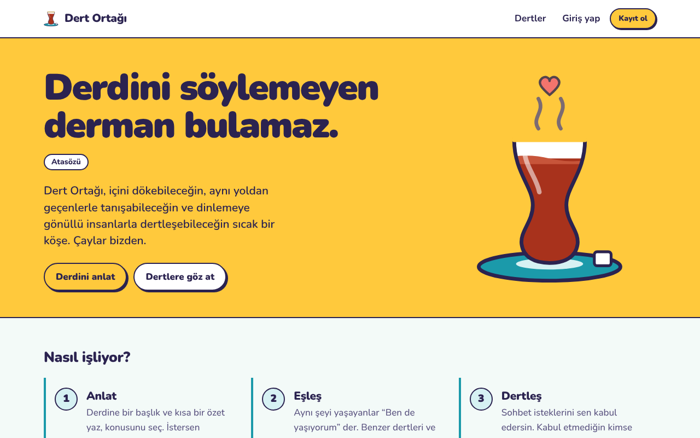
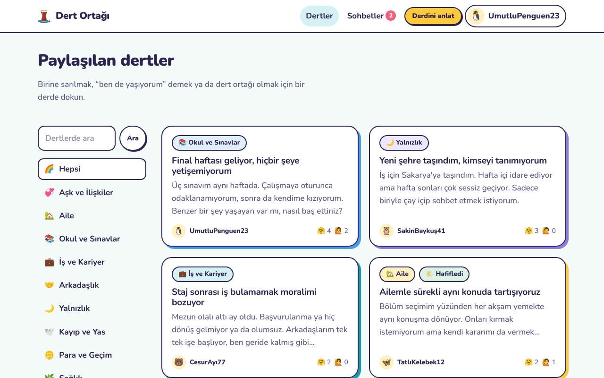
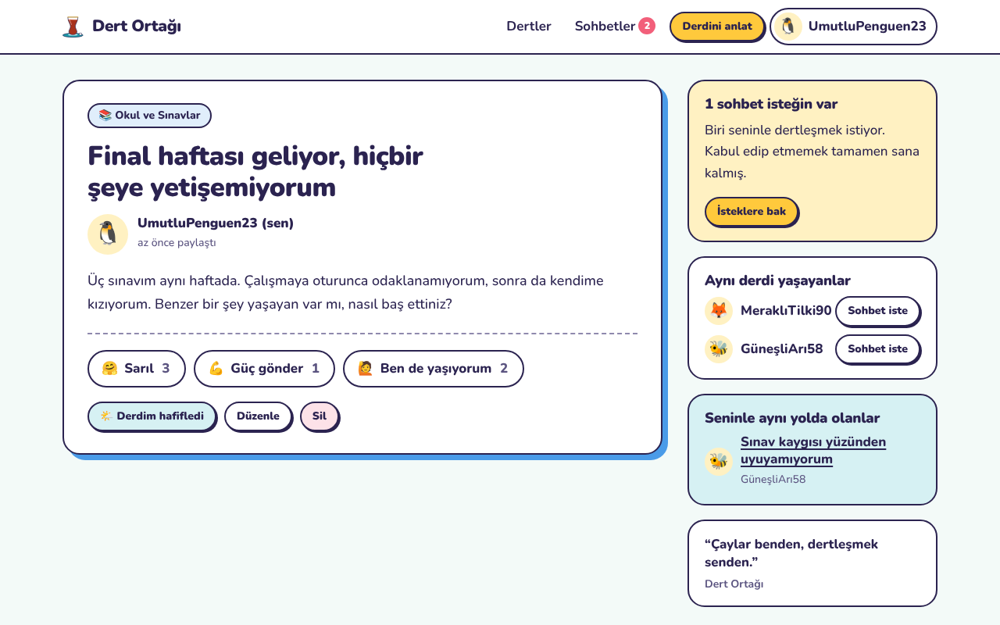
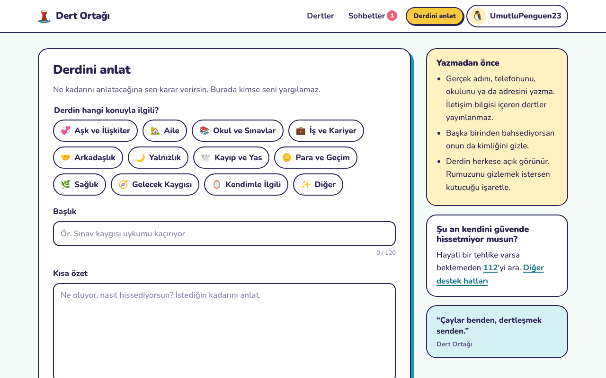
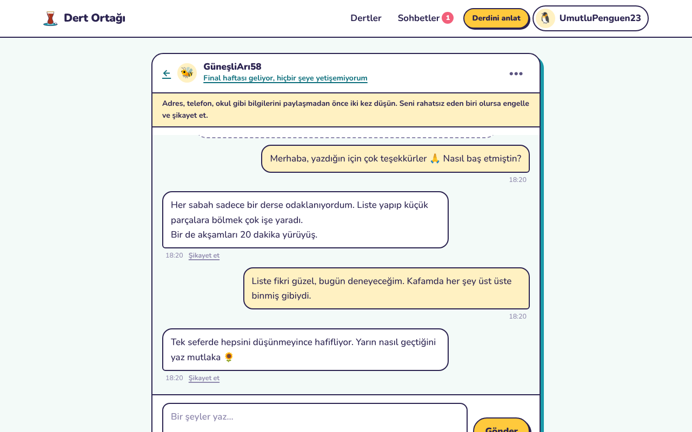
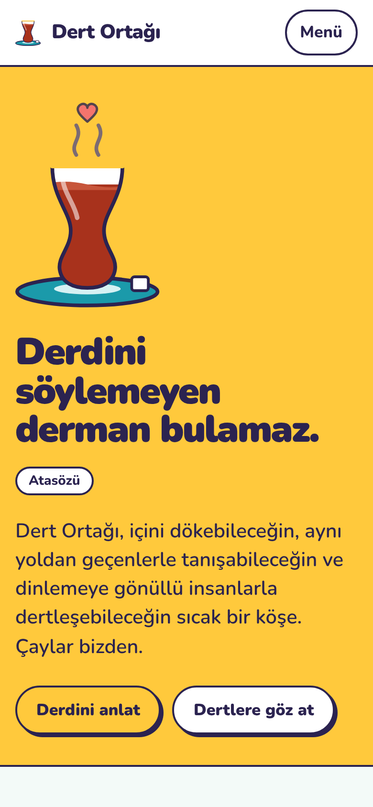
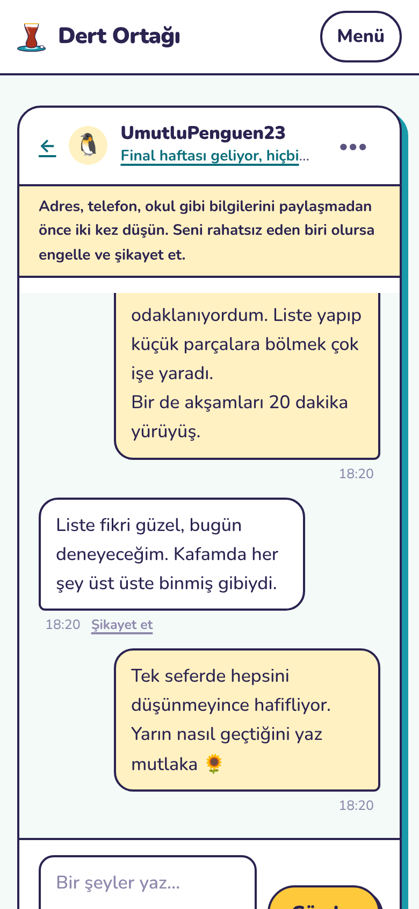

# 🫖 Dert Ortağı

> *Derdini söylemeyen derman bulamaz.*

**Dert Ortağı**, insanların dertlerini paylaşabildiği, aynı derdi yaşayanlarla eşleşebildiği ve dinlemeye gönüllü kişilerle birebir dertleşebildiği bir dayanışma platformudur. Güvenlik, gizlilik ve KVKK uyumu ilk günden tasarımın merkezine konarak Django ile geliştirilmiştir.



> [!IMPORTANT]
> Bu bir portföy / öğrenme projesidir ve canlıya alınmamıştır. Yasal metinler şablon niteliğindedir; gerçek kullanıcılarla yayına almadan önce [Canlıya almadan önce](#canlıya-almadan-önce) bölümüne mutlaka göz at. Dert Ortağı profesyonel psikolojik destek veya kriz hizmeti değildir.

---

## İçindekiler

- [Özellikler](#özellikler)
- [Ekran görüntüleri](#ekran-görüntüleri)
- [Teknolojiler](#teknolojiler)
- [Kurulum](#kurulum)
- [Testler ve kalite kontrolleri](#testler-ve-kalite-kontrolleri)
- [Güvenlik](#güvenlik)
- [KVKK ve gizlilik](#kvkk-ve-gizlilik)
- [Proje yapısı](#proje-yapısı)
- [Yol haritası](#yol-haritası)
- [Lisans](#lisans)

## Özellikler

### 💬 Dert paylaşma
- Derdine **kategori**, **başlık** ve **kısa özet** ekleyerek paylaş (12 kategori: Aile, Okul ve Sınavlar, Yalnızlık, Kayıp ve Yas…).
- İstersen **rumuzunu gizle**; derdin “Anonim dert ortağı” olarak görünür ve sohbette de anonim kalırsın.
- Derdin geçince **“Derdim hafifledi 🌤️”** olarak işaretle.
- Herkese açık dertlerde telefon, e-posta, bağlantı ve sosyal medya hesabı paylaşımı otomatik olarak engellenir.

### 🤝 Eşleşme
- Her derde **🤗 Sarıl**, **💪 Güç gönder** veya **🙋 Ben de yaşıyorum** tepkisi verilebilir.
- “Ben de yaşıyorum” diyenler dert sahibine listelenir; dert sahibi onlara sohbet isteği gönderebilir.
- **Benzer dertler**, kategori ve kelime benzerliğine göre önerilir.
- **Dinleyici gönüllüleri** seçtikleri konularda, henüz kimseyle konuşamamış dertleri ayrı bir listede görür.

### 🫖 Güvenli sohbet
- Sohbet bir **istekle** başlar; karşı taraf kabul etmeden tek bir mesaj bile gönderilemez.
- Sohbet istenildiği an bitirilebilir; yeni mesajlar birkaç saniyede bir otomatik gelir.
- Okunmamış mesaj ve bekleyen istek rozeti.

### 🛡️ Şikayet, engelleme ve moderasyon
- Dert, mesaj veya kişi **şikayet edilebilir** (taciz, tehdit, cinsel içerik, dolandırıcılık, 18 yaş altı, kendine zarar riski…).
- **Engelleme** iki yönlüdür: taraflar birbirinin dertlerini göremez, mesajlaşamaz; açık sohbetler kapanır.
- 3 farklı kişiden şikayet alan dert, moderatör bakana kadar **otomatik gizlenir**.
- Yönetim panelinde şikayet kuyruğu ve toplu işlemler (içeriği kaldır, hesabı askıya al). Özel mesajlar panelde **listelenmez**; moderatör yalnızca şikayet edilen mesajın kopyasını görür.

### 💛 Kriz desteği
- Dert veya mesajda kendine zarar vermeyle ilgili ifadeler algılanırsa yazan kişiye **112** ve **ALO 183** hatları gösterilir. Bu tespit hiçbir yere kaydedilmez.
- Her sayfanın altında acil durum hatırlatması ve ayrı bir [destek hatları](core/templates/core/destek.html) sayfası.

### 🗝️ KVKK hakları site içinde
- Kayıtta yalnızca rumuz ve parola; e-posta isteğe bağlı. Ad-soyad, telefon, fotoğraf **toplanmaz**; avatar bir emoji.
- Özel nitelikli veriler için kayıttan **ayrı ve isteğe bağlı açık rıza** adımı; rıza her an geri alınabilir.
- **Verilerimi indir** (JSON), **hesabımı sil**, rıza ve onay geçmişi (sürümüyle birlikte).
- Saklama sürelerini aşan veriler için `kvkk_temizlik` komutu.

### 🌻 Neşeli bir arayüz
- İnce belli çay bardağı, çini turkuazı, ayçiçeği sarısı ve nar çiçeği pembesinden oluşan sıcak bir tema.
- Atasözleri, halk sözleri ve Yunus Emre'den dizelerle dönen “günün sözü”.
- Mobil uyumlu, klavyeyle gezilebilir, `prefers-reduced-motion` desteği.

## Ekran görüntüleri

| Dertler | Dert detayı (sahibi gözünden) |
|---|---|
|  |  |
| **Derdini anlat** | **Sohbet** |
|  |  |

<p align="center">
  
  &nbsp;&nbsp;
  
</p>

## Teknolojiler

| Katman | Kullanılan |
|---|---|
| Arka uç | Python 3.12+, Django 6.1 |
| Veritabanı | SQLite (geliştirme), PostgreSQL (isteğe bağlı) |
| Ön yüz | Django şablonları, saf CSS, az miktarda saf JavaScript (çerçeve yok) |
| Yazı tipi | Nunito (sunucudan servis edilir, üçüncü taraf istek yok) |
| Statik dosyalar | WhiteNoise |
| Kalite | Django test çatısı (54 test), ruff, bandit, pip-audit, gitleaks, GitHub Actions |

Bilerek **az bağımlılık** kullanıldı: üretim için yalnızca Django, WhiteNoise ve python-dotenv. Hız sınırlama, kriz algılama ve eşleşme gibi parçalar projenin içinde yazıldı.

## Kurulum

Gerekenler: **Python 3.12 veya üstü** ve Git.

```bash
# 1. Depoyu klonla
git clone https://github.com/talhanl208/dert-ortagi.git
cd dert-ortagi

# 2. Sanal ortam oluştur ve etkinleştir
python -m venv .venv
source .venv/bin/activate        # Windows: .venv\Scripts\activate

# 3. Bağımlılıkları kur
pip install -r requirements.txt

# 4. Ortam değişkenlerini hazırla
cp .env.example .env             # Windows: copy .env.example .env
python -c "import secrets; print(secrets.token_urlsafe(50))"
# Çıkan değeri .env içindeki DJANGO_SECRET_KEY satırına yapıştır.

# 5. Veritabanını oluştur
python manage.py migrate

# 6. (İsteğe bağlı) Örnek kullanıcılar ve dertler
python manage.py ornek_veri      # Geçici parola terminale yazdırılır

# 7. (İsteğe bağlı) Moderatör hesabı
python manage.py createsuperuser

# 8. Çalıştır
python manage.py runserver
```

Site: <http://127.0.0.1:8000> · Yönetim paneli: <http://127.0.0.1:8000/yonetim/> (adresi `.env` içindeki `DJANGO_ADMIN_URL` ile değiştirebilirsin).

**PostgreSQL kullanmak için:** `requirements.txt` içindeki `psycopg` satırını aç, `.env` içinde `DB_ENGINE=postgres` ve `POSTGRES_*` değerlerini doldur.

## Testler ve kalite kontrolleri

```bash
pip install -r requirements-dev.txt

python manage.py test                     # 54 test
ruff check . && ruff format --check .     # Kod stili + güvenlik kuralları
bandit -c pyproject.toml -r .             # Statik güvenlik analizi
pip-audit -r requirements.txt             # Bilinen açığı olan paket var mı?
python manage.py check --deploy           # Canlı ortam ayar kontrolü (DJANGO_DEBUG=False iken)
```

Testler; yetkisiz erişimi (IDOR), XSS kaçışını, engelleme ve şikayet akışlarını, anonimliğin korunmasını, açık rıza geri alındığında verilerin silinmesini, hız sınırlarını ve güvenlik başlıklarını kapsar. Aynı kontroller her `push`'ta [GitHub Actions](.github/workflows/ci.yml) ile otomatik çalışır.

## Güvenlik

Ayrıntılı liste için [SECURITY.md](SECURITY.md). Öne çıkanlar:

- **Depoda sır yok.** Tüm anahtarlar `.env`'den okunur; `DJANGO_SECRET_KEY` yoksa uygulama başlamaz. `DEBUG` varsayılan olarak kapalıdır.
- **Katı içerik güvenliği politikası (CSP):** satır içi script ve stil yok, dışarıdan hiçbir kaynak yüklenmez, site başka bir sayfaya gömülemez.
- **Kaba kuvvet koruması:** giriş, kayıt, parola sıfırlama ve yönetim girişinde hız sınırı; aynı rumuza art arda hatalı denemede geçici kilit.
- **Yetkilendirme:** her nesne tahmin edilemez UUID ile adreslenir; başkasının sohbetine veya mesajına erişmeye çalışan 404 alır.
- **Anonimlik:** kullanıcı kimlikleri herkese açık sayfalarda görünmez; şikayet ve engelleme her zaman bir dert veya sohbet üzerinden yapılır.
- **Gizlilik başlıkları:** HSTS, `nosniff`, `Referrer-Policy`, `Permissions-Policy`; oturum açıkken sayfalar tarayıcıda önbelleğe alınmaz.
- **Saldırı yüzeyi küçük:** dosya yükleme yok, istek boyutu sınırlı, yönetim paneli `/admin/` adresinde değil.

Bir açık bulursan lütfen herkese açık issue yerine [SECURITY.md](SECURITY.md)'deki gizli bildirim yolunu kullan.

## KVKK ve gizlilik

| Gereksinim | Projede nasıl karşılandı? |
|---|---|
| Aydınlatma yükümlülüğü (m.10) | [Aydınlatma Metni](core/templates/core/legal/aydinlatma.html): veri kategorileri, amaçlar, hukuki sebepler, aktarım, saklama süreleri, haklar |
| Açık rıza (m.6) | Özel nitelikli veriler (sağlık vb.) için **ayrı** [Açık Rıza Metni](core/templates/core/legal/acik_riza.html) ve ayrı onay adımı. Aydınlatma metni “onaylatılmaz”, yalnızca bilgilendirilir. Hesap açmak rızaya bağlanmaz. |
| Rızanın geri alınması | Tek tıkla; rızaya dayanan veriler (dertler, “ben de” tepkileri, mesajlar) silinir |
| Veri minimizasyonu | Ad-soyad, telefon, fotoğraf, doğum tarihi toplanmaz; e-posta isteğe bağlı; IP adresleri yalnızca tuzlanmış özet olarak ve geçici bellekte |
| İlgili kişi hakları (m.11) | Verilerimi indir (JSON), hesabımı sil, rıza geçmişi |
| Saklama ve imha | Süreler `.env` ile ayarlanır; `python manage.py kvkk_temizlik` süresi dolan verileri siler |
| Yurt dışına aktarım (m.9) | Analiz, reklam, CDN veya Google Fonts yok; varsayılan kurulumda yurt dışına aktarım yok |
| Çerezler | Yalnızca zorunlu oturum ve CSRF çerezleri ([Çerez Politikası](core/templates/core/legal/cerez_politikasi.html)) |
| Yaş sınırı | Kayıtta 18 yaş beyanı; 18 yaş altı şikayet sebebi olarak bildirilebilir |

### Canlıya almadan önce

Proje yayına alınacaksa bunlar **mutlaka** yapılmalı:

1. `.env` içinde `DJANGO_DEBUG=False`, güçlü bir `DJANGO_SECRET_KEY`, doğru `DJANGO_ALLOWED_HOSTS` ve tahmin edilmesi zor bir `DJANGO_ADMIN_URL` ayarla; HTTPS kullan.
2. `DATA_CONTROLLER_*` değişkenleriyle **veri sorumlusu bilgilerini** doldur.
3. Tüm yasal metinleri bir **hukukçuya** kontrol ettir; VERBİS kayıt yükümlülüğünü ve 5651 sayılı Kanun kapsamındaki yükümlülükleri değerlendir.
4. Sunucu yurt dışındaysa yurt dışına aktarım (KVKK m.9) açısından değerlendirme yap ve metinleri güncelle.
5. `kvkk_temizlik` komutunu günlük çalışacak şekilde zamanla (cron / systemd timer).
6. Birden fazla süreçle çalışacaksan hız sınırlama için Redis gibi paylaşımlı bir önbellek kullan.
7. Destek hattı numaralarının güncelliğini kontrol et ve gerçek bir **moderasyon ekibi** ile kriz anında izlenecek bir süreç belirle.

## Proje yapısı

```
dert-ortagi/
├── config/            # Ayarlar, URL'ler (güvenlik ayarlarının hepsi settings.py'de)
├── core/              # Ana sayfa, yasal metinler, tema, hız sınırlama, metin analizi,
│   │                  # güzel sözler, KVKK temizlik ve örnek veri komutları
│   ├── static/        # CSS, JS, Nunito yazı tipi, favicon
│   └── templates/
├── accounts/          # Kayıt/giriş, rumuz ve avatar, açık rıza, veri indirme, hesap silme
├── dertler/           # Dertler, kategoriler, tepkiler, benzer dert eşleşmesi, dinleyici akışı
├── sohbet/            # Sohbet istekleri, mesajlaşma, okunmamış takibi
├── guvenlik/          # Şikayet, engelleme, otomatik gizleme, moderasyon paneli
├── docs/              # Ekran görüntüleri
└── .github/           # CI (test + güvenlik taraması) ve Dependabot
```

## Yol haritası

Projeyi daha da geliştirmek için fikirler:

- [ ] **Gerçek zamanlı sohbet:** Django Channels + WebSocket ile yoklama yerine anlık mesajlar
- [ ] **Dert çemberleri:** aynı derdi yaşayan 4–6 kişilik küçük, moderasyonlu grup sohbetleri
- [ ] **Daha akıllı eşleşme:** Türkçe kök bulma (Zemberek) veya anlamsal benzerlik ile öneri
- [ ] **Dinleyici rozetleri ve kısa “iyi dinleyici” rehberi**
- [ ] **Teşekkür notu:** sohbet bitince dert ortağına anonim bir “iyi geldin” mesajı
- [ ] **Moderatörler için iki adımlı doğrulama (2FA)**
- [ ] **E-posta doğrulama** ve isteğe bağlı bildirimler
- [ ] **Uygunsuz dil filtresi** ve şikayetler için öncelik sıralaması
- [ ] **Karanlık mod** ve PWA (ana ekrana eklenebilir uygulama)
- [ ] **Docker** ile tek komutla kurulum

## Katkıda bulunma

Öneri ve katkılara açığız. Bir issue açarak başlayabilir ya da fork'layıp pull request gönderebilirsin. PR göndermeden önce testlerin ve `ruff check .` komutunun geçtiğinden emin ol.

## Lisans

[MIT](LICENSE) © 2026 Talha Ünlü

Nunito yazı tipi [SIL Open Font License 1.1](core/static/fonts/OFL-Nunito.txt) ile lisanslıdır.

---

<p align="center"><i>“Gönül ne kahve ister ne kahvehane, gönül sohbet ister, kahve bahane.”</i></p>
